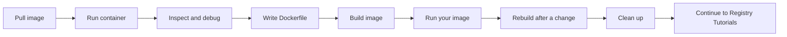

---
tags:
  - Containers
  - Docker
  - Podman
---

# Container Tool Tutorials

This page walks through the workflow of a typical container build using either Docker or Podman. By the end you will have pulled an image, run a container, written a Dockerfile, built and rebuilt your own image, and cleaned up. You will then continue to the [Registry Tutorials](registry-tutorials.md) to push it to a registry.

!!! tip "Choose your tool once"
    Every command block below has a **Podman** and a **Docker** tab. Selecting a tab switches all of the tabs on this page, so you only need to choose once.

## Prerequisites

- Docker or Podman installed ([Install Podman](https://podman.io/docs/installation){target="_blank"} or [Install Docker](https://docs.docker.com/get-started/get-docker/){target="_blank"})
- A terminal
- A text editor

## The Workflow



## 1. Verify your installation

Confirm the tool is installed and, for Docker, that the daemon is reachable.

=== "Podman"

    ```bash
    podman --version
    podman info
    ```

    !!! note "macOS and Windows"
        Podman runs containers inside a Linux virtual machine on these platforms. Create and start it once before running any other command:

        ```bash
        podman machine init
        podman machine start
        ```

=== "Docker"

    ```bash
    docker --version
    docker info
    ```

    !!! note "Docker daemon"
        If `docker info` reports it cannot connect to the daemon, start Docker Desktop (or the `docker` service on Linux) and try again.

## 2. Pull an image

An **image** is a read-only template that contains an application and everything it needs to run. Images are downloaded from a registry.

=== "Podman"

    ```bash
    podman pull docker.io/library/nginx:1.29-alpine
    ```

    !!! info "Fully qualified names"
        Podman can search several registries, so it is best practice to include the registry (`docker.io/library/`) in the image name.

=== "Docker"

    ```bash
    docker pull nginx:1.29-alpine
    ```

    !!! info "Short names"
        Docker assumes Docker Hub when no registry is given, so `nginx:1.29-alpine` is shorthand for `docker.io/library/nginx:1.29-alpine`.

List the images stored locally:

=== "Podman"

    ```bash
    podman images
    ```

=== "Docker"

    ```bash
    docker images
    ```

```text
REPOSITORY                  TAG          IMAGE ID      CREATED       SIZE
docker.io/library/nginx     1.29-alpine  a1b2c3d4e5f6  2 weeks ago   52.5 MB
```

The `TAG` identifies a version of the image. Prefer explicit tags such as `1.29-alpine` over `latest`, which can change without warning.

## 3. Run a container

A **container** is a running instance of an image. Start an NGINX web server in the background (`-d`), give it a name, and map port 8080 on your machine to port 80 in the container.

=== "Podman"

    ```bash
    podman run -d --name web -p 8080:80 docker.io/library/nginx:1.29-alpine
    ```

=== "Docker"

    ```bash
    docker run -d --name web -p 8080:80 nginx:1.29-alpine
    ```

| Flag | Purpose |
| ---- | ------- |
| `-d` | Run in the background (detached) |
| `--name web` | Give the container a friendly name |
| `-p 8080:80` | Publish container port 80 on host port 8080 |

Open [http://localhost:8080](http://localhost:8080){target="_blank"} or use `curl`:

```bash
curl http://localhost:8080
```

You should see the default NGINX welcome page.

## 4. Inspect and debug a running container

List running containers:

=== "Podman"

    ```bash
    podman ps
    ```

=== "Docker"

    ```bash
    docker ps
    ```

!!! tip "Show stopped containers too"
    Add `-a` (for example `podman ps -a` or `docker ps -a`) to include containers that have exited.

View the container's logs:

=== "Podman"

    ```bash
    podman logs web
    ```

=== "Docker"

    ```bash
    docker logs web
    ```

Open a shell inside the running container to look around:

=== "Podman"

    ```bash
    podman exec -it web /bin/sh
    ```

=== "Docker"

    ```bash
    docker exec -it web /bin/sh
    ```

Inside the container, try a few commands, then leave the shell:

```bash
ls /usr/share/nginx/html
cat /etc/os-release
exit
```

View the full configuration of the container as JSON:

=== "Podman"

    ```bash
    podman inspect web
    ```

=== "Docker"

    ```bash
    docker inspect web
    ```

## 5. Stop and remove the container

Containers are disposable. Stop the container, then remove it.

=== "Podman"

    ```bash
    podman stop web
    podman rm web
    ```

=== "Docker"

    ```bash
    docker stop web
    docker rm web
    ```

!!! note "Container vs. image"
    Removing a container does not remove the image it was created from. You can start a new container from the same image at any time.

## 6. Write a Dockerfile

So far you have used someone else's image. To package your own application, you describe the image in a text file. Create a new directory with two files:

```bash
mkdir my-web-app && cd my-web-app
```

**`index.html`**

```html
<!DOCTYPE html>
<html>
  <head><title>My First Image</title></head>
  <body>
    <h1>Hello from my own container image!</h1>
  </body>
</html>
```

**`Dockerfile`**

```dockerfile
# Start from a small, official base image
FROM docker.io/library/nginx:1.29-alpine

# Copy our page into the directory NGINX serves
COPY index.html /usr/share/nginx/html/index.html

# Document the port the application listens on
EXPOSE 80
```

| Instruction | Purpose |
| ----------- | ------- |
| `FROM` | The base image your image is built on top of |
| `COPY` | Copies files from your machine into the image |
| `EXPOSE` | Documents the port the application listens on |

!!! info "Dockerfile or Containerfile"
    Both tools read a file named `Dockerfile`. Podman also recognises the vendor-neutral name `Containerfile`; the format is identical.

## 7. Build the image

Run the build from the directory that contains your `Dockerfile`. The `-t` flag names and tags the resulting image, and the trailing `.` is the **build context**, the set of files available to `COPY`.

=== "Podman"

    ```bash
    podman build -t my-web-app:v1.0 .
    ```

=== "Docker"

    ```bash
    docker build -t my-web-app:v1.0 .
    ```

Each instruction in the Dockerfile produces a **layer**. Layers are cached, so rebuilds only repeat the steps that changed. View them with:

=== "Podman"

    ```bash
    podman history my-web-app:v1.0
    ```

=== "Docker"

    ```bash
    docker history my-web-app:v1.0
    ```

## 8. Run your image

=== "Podman"

    ```bash
    podman run -d --name my-web-app -p 8080:80 localhost/my-web-app:v1.0
    ```

    !!! info "The `localhost/` prefix"
        Podman prefixes images built locally with `localhost/`.

=== "Docker"

    ```bash
    docker run -d --name my-web-app -p 8080:80 my-web-app:v1.0
    ```

Verify your page is being served:

```bash
curl http://localhost:8080
```

You should see `Hello from my own container image!`.

## 9. Make a change and rebuild

Edit `index.html`, for example change the heading text, then rebuild with a new tag:

=== "Podman"

    ```bash
    podman build -t my-web-app:v1.1 .
    ```

=== "Docker"

    ```bash
    docker build -t my-web-app:v1.1 .
    ```

Notice that the base image layer is reused from the cache and only the `COPY` layer is rebuilt. Replace the running container with the new version:

=== "Podman"

    ```bash
    podman rm -f my-web-app
    podman run -d --name my-web-app -p 8080:80 localhost/my-web-app:v1.1
    ```

=== "Docker"

    ```bash
    docker rm -f my-web-app
    docker run -d --name my-web-app -p 8080:80 my-web-app:v1.1
    ```

## 10. Clean up

Remove the running container:

=== "Podman"

    ```bash
    podman rm -f my-web-app
    ```

=== "Docker"

    ```bash
    docker rm -f my-web-app
    ```

!!! tip "Removing the images"
    Do not remove your images yet. The `my-web-app:v1.1` image is needed for the [Registry Tutorials](registry-tutorials.md) that follow. Once you have finished those, remove the images with:

    === "Podman"

        ```bash
        podman rmi my-web-app:v1.0 my-web-app:v1.1
        ```

    === "Docker"

        ```bash
        docker rmi my-web-app:v1.0 my-web-app:v1.1
        ```

!!! tip "Remove unused resources in bulk"
    `podman system prune` / `docker system prune` removes stopped containers, dangling images, and unused networks. Review the prompt before confirming.

## Next Steps

You have now pulled an image, run and inspected a container, written a Dockerfile, built and rebuilt your own image, and cleaned up. The next step in a typical workflow is sharing an image by pushing it to a container registry.

!!! success "Continue to the Registry Tutorials"
    Continue with the [Registry Tutorials](registry-tutorials.md) to log in to a registry, tag your `my-web-app:v1.1` image, and push it to Docker Hub, Quay.io, or IBM Cloud Container Registry.

## Command Summary

| Task | Podman | Docker |
| ---- | ------ | ------ |
| Pull an image | `podman pull <image>` | `docker pull <image>` |
| List images | `podman images` | `docker images` |
| Run a container | `podman run -d --name <name> -p <host>:<container> <image>` | `docker run -d --name <name> -p <host>:<container> <image>` |
| List containers | `podman ps -a` | `docker ps -a` |
| View logs | `podman logs <name>` | `docker logs <name>` |
| Shell into a container | `podman exec -it <name> /bin/sh` | `docker exec -it <name> /bin/sh` |
| Build an image | `podman build -t <name>:<tag> .` | `docker build -t <name>:<tag> .` |
| Stop / remove a container | `podman stop <name>` / `podman rm <name>` | `docker stop <name>` / `docker rm <name>` |
| Remove an image | `podman rmi <image>` | `docker rmi <image>` |

## Resources

[Podman Documentation :fontawesome-brands-redhat:](https://docs.podman.io/){ .md-button target="_blank"}
[Docker Documentation :fontawesome-brands-docker:](https://docs.docker.com/){ .md-button target="_blank"}
[Dockerfile Reference :fontawesome-brands-docker:](https://docs.docker.com/reference/dockerfile/){ .md-button target="_blank"}
